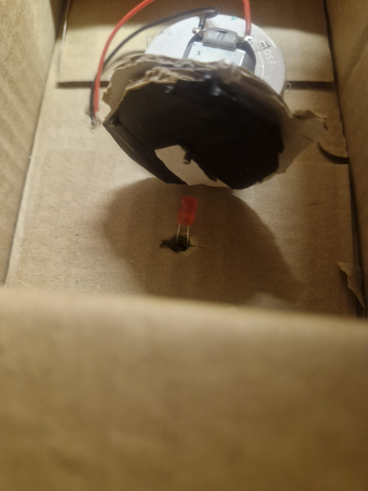
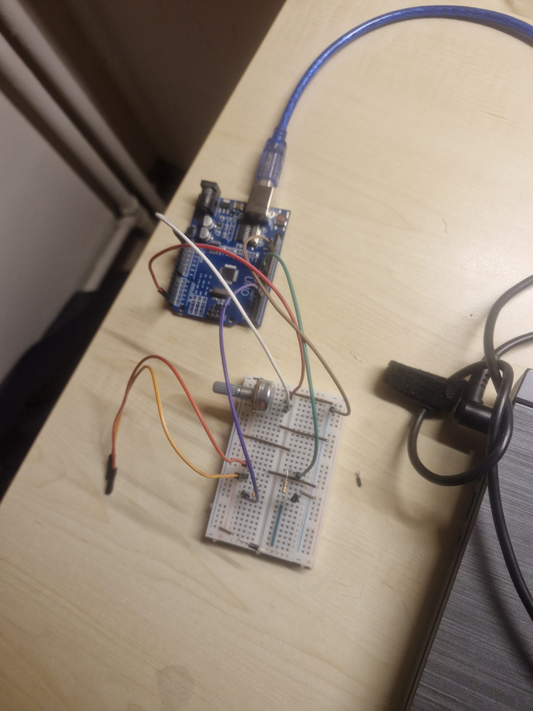

# STREBOSCOPE
### Problem and the Purpose
Imagine a rotational motion or a tool you want to work with. How can you measure its identities, namely its frequency hence the rotational speed? By using optical and wave principles, one can measure a rotational speed, which is what a industrial mechanical streboscope does. A mechanical streboscope enables us to observe the rotational identities by a set up light source whereas a laser streboscope uses diode laser to observe the same effect. We will analyze the first one.
## Theory
Imagine a rotational disc, which taped with black band and has a white reflective white strip on it. We can assume the system as a rotating clock in a dark enclosed system with brightened just to see the strip. Hence, its rotational speed $w$ is 
$$w=\frac{2\pi}{f}$$
where $f$ is its frequency. So, if the strip is rotating with a frequency $f$ and if we look directly to the strip with the same frequency, we would observe that the strip do not move at all, relatively. We are bound to say relatively because the disc is rotating as expected but our eyes cannot distinguish it, which is called *streboscopic effect*. 
### How to observe?
As one can see from the analogy, we would not just observe this effect at the period $T$ but also at $2T$,$3T$.. $=nT$ where $n=1,2,3...$ etc. Therefore we cannot directly say that the frequency of the rotation is what we have observed. Instead, it has a relation as:
$$\frac{1}{f_{observed}}=T_{observed}=nT_{fundamental}$$
$$f_{observed}=\frac{f_0}{n}$$
where $f_0$ is the fundamental frequency. Since we cannot distinguish which harmonic mode we are observing, we need two consecutive stationary observation. 
$$\frac{1}{f_1}=\frac{n}{f_0}$$
and 
$$\frac{1}{f_2}=\frac{n+1}{f_0}$$
$$\frac{1}{f_2}-\frac{1}{f_1}=\frac{1}{f_0}$$
Hence, by observing two consecutive mode frequency, we can determine the fundamental frequency of the rotational disc.
## Experimental Setup
To rotate the disc, we setup a dc motor controlled by Arduino. The disc is taped with black band to absorb the light so that one can observe the system sufficiently. We also have a white cardboard between the dc motor and the black disc in order to improve the visibility. We illuminate the system with a red LED from the bottom in a isolated cardbox the system that is sufficient to use.
<p align="center">

</p>
<p align="center">
  
</p>

| Component | Arduino Pin | Notes |
| :--- | :---: | :--- |
| **Potentiometer (Wiper)** | `A5` | Controls LED strobe frequency |
| **Strobe LED (+)** | `D13` orange wire on the left *(or your pin)* | Series current-limiting resistor |
| **Motor Driver (Transistor Base)** | `D9` *(PWM)* | Drives DC motor with flyback diode |

### Methodology and Controlling the LED
For simplicity, we use a potantiometer to adjust the frequency of the LED manually. The analog reading from the potantiometer will return a value between 0-1023 and say we want to adjust the frequency between 0-150. Our algorithm should operates as:
* The LED is initially off.
* Turn on the LED
* wait about a half period $\frac{T}{2}$
    * This is why we use $1/2$ at the assigning the period at the line 56
* Turn off the LED

Thus, the function in the file
```arduino
void cycle() {
  isOn=wait();
  if (isOn==true) {
    digitalWrite(ledPin,HIGH);
  }
  else if (isOn==false) {
    digitalWrite(ledPin,LOW);
  }
```
operates this process. The boolen value *isOn* changes its value for each period with the function *wait()* that works under the built-in function *micros()* to track the amount of time the system is processing. Finally, the system prints out the frequency calculated at each loop to the serial monitor.
## Results
The results were observed manually and written manually instead of algorithmically for simplicity.
### Recorded Measurements (at 200/255 PWM)

| Trial | Observed Lock Frequency (Hz) |
| :---: | :---: |
| **1** | 69.65 $\pm 0.8$ |
| **2** | 69.79 $\pm 0.8$|
| **3** | 34.60 $\pm 0.8$|
| **4** | 34.46 $\pm 0.8$|

https://github.com/user-attachments/assets/34c68d01-8a90-444c-8b4a-d5a8f7687be6


**Result:**
Using the consecutive stationary frequencies by taking average ($f_{\text{high}} \approx 69.72\text{ Hz}$ and $f_{\text{low}} \approx 34.53\text{ Hz}$), the fundamental rotational frequency of the motor is:

$$f_{\text{motor}} = \frac{f_{\text{high}} \cdot f_{\text{low}}}{f_{\text{high}} - f_{\text{low}}} \approx \mathbf{68.4 \pm 0.8 \text{ Hz}} \quad (\approx \mathbf{4100\text{ RPM}})$$
